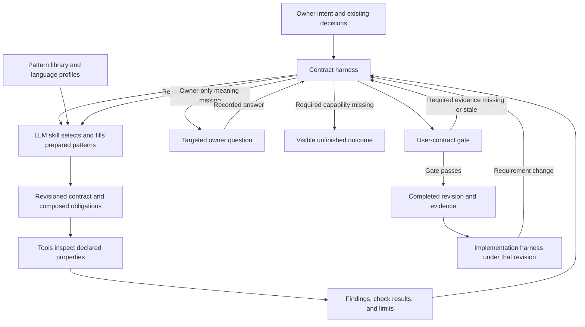

# Contract as a Code: product concept

Revision: concept-draft-1. Status: proposal. Owner acceptance: absent. T01 independent review: pending.

CAAC treats a contract as a program that defines permitted behavior with explicit programming semantics.
Its primary product is a controller that completes contracts above an implementation harness.
Prepared patterns, an LLM skill, and tools support that controller.
The completed contract then constrains the implementation harness's work and judgments.

This document proposes product roles, authority, foundations, and the conceptual release boundary.
It does not establish implemented capability or resolve the owner's D01/D02 decisions.

## Owner direction and source

The following links preserve sources. The descriptions are interpretations, not replacement quotations.
No source text or source timestamp changes through this design.

| Source | Direction preserved here | Design responsibility |
| --- | --- | --- |
| B05 | STE100, Paperthin, and YAGNI form distinct foundations. | Foundation rules below. |
| B06–B09 | The contract is code. Programming precision applies before implementation. v2 remains separate. | Product premise, authority, T02–T05 semantics. |
| B12 | Support scratch, plugin, and migration work. | T08–T10 mode contracts. |
| B13–B16 | Rust tools support a skill that runs through an LLM. | Separate skill, tools, and host responsibilities. |
| B17–B23 | Prepare programming counterparts, slots, nesting, patterns, and language meaning. | Broad library and explicit capability coverage. |
| B24–B27 | The contract sits above the harness. Repeat until the contract is complete. | Controller loop and downstream handoff. |
| S02: supplied explanation | Select, fill, compose, check, repair, question, resume, and assess evidence. | Responsibility flow and completion authority. |
| S01: current delegation | Divide conceptual work among Sol high agents. | Design authorization, not product acceptance. |

RUN-001 identifies S01–S03 and their SHA-256 hashes.
B01–B04 concern the prior audit. B10–B11 request implementation. B18 contains no complete product requirement.
These messages do not establish additional accepted v2 capabilities.

## Terms and responsibility boundaries

| Term | Meaning and boundary |
| --- | --- |
| Owner | Person who decides requirements and accepts an exact baseline. An agent cannot infer this acceptance. |
| Contract | Revisioned obligations, prohibitions, and permissions that define permitted behavior within a stated scope. |
| Clause | One independently reviewable obligation, prohibition, or permission. |
| Observable | An exposed result, error, state change, or external effect. |
| Pattern | Prepared programming structure with slots, meaning, composition rules, and checks. |
| Pattern instance | One selected pattern with values bound to its slots. |
| Slot | Named required or optional value. Its definition states type, meaning, and the conditions that require it. |
| Pattern library | Maintained definitions of patterns and their prepared counterparts. It does not choose an owner's requirement values. |
| Language profile | Declared mapping between a language's relevant semantics and contract structures, with support limits. |
| Tool | Callable implementation that performs a declared operation and reports results, findings, failures, and limits. |
| LLM skill | Instructions that guide interpretation, pattern selection, slot filling, contract writing, repair, and owner questions. |
| Host | Environment that runs the LLM skill, controller, and available tools. It supplies execution capabilities and runtime authorization. |
| Contract harness | Controller that schedules contract work, retains evidence, tracks unresolved obligations, and evaluates the user-contract gate. |
| Implementation harness | Downstream controller that implements behavior under a completed contract and its declared action boundary. |
| Reviewer | Actor who checks clauses and cases against criteria. Required independent review excludes the designer of that artifact. |
| Finding | Recorded defect, missing decision, unsupported requirement, or failed check linked to affected contract content. |
| Evidence | Revision-bound source, decision, review result, or tool result. Its declared coverage limits its use. |
| Capability gap | Required semantics, check, or action control without declared support. An LLM guess does not supply support. |
| Complete contract | Exact revision that passes the declared user-contract gate for its selected capability profile. |
| User-contract gate | T11's predicate for one user's contract. It consumes decisions, checks, reviews, and their freshness. |
| Conceptual gate | T14's review of the integrated product design. It does not run the product's user-contract gate. |

The skill proposes content. The tools inspect declared properties. The controller manages the process and evaluates its gate.
The owner decides owner-only meaning. The reviewer supplies required review evidence.
Neither the controller nor a tool can turn a proposal into owner acceptance.

## Responsibility flow

Tools check both pattern instances and obligations introduced between composed patterns.
For example, payment success followed by shipment failure needs a defined recovery result.
A retry also needs duplicate-effect semantics. Selecting retry and payment patterns alone does not resolve their interaction.
The library supplies prepared obligations and checks. Owner requirements supply the particular values and permitted outcomes.

The flow expresses responsibilities. T06 defines tool interfaces. T07 defines skill actions. T11 defines exact states and termination.
T12 defines downstream interception, runtime permission, nonconformance, and supported action coverage.

## Product constraints

These proposed clauses govern the product concept. Method clauses remain in [CONTRACT.md](../CONTRACT.md).

CONCEPT-001 | The contract harness must complete contract work before delegating implementation under that contract revision.

CONCEPT-002 | The implementation harness must treat the completed contract as authority for required observable behavior within its scope.

CONCEPT-003 | The contract harness must retain the exact completed revision, capability profile, decisions, and completion evidence.

CONCEPT-004 | The LLM skill must select prepared patterns instead of inventing unsupported pattern semantics.

CONCEPT-005 | The pattern library must define slots, meaning, composition obligations, and checks for each declared supported pattern.

CONCEPT-006 | The LLM skill must expose missing owner requirements instead of selecting invented values.

CONCEPT-007 | The contract harness must reject completion while a required decision, finding, or check remains unresolved.

CONCEPT-008 | The contract harness must reject an LLM completion statement as a substitute for required evidence.

CONCEPT-009 | Tools must report their coverage limits without treating an unsupported required check as passed.

CONCEPT-010 | The LLM skill must expose a required unsupported language feature as a capability gap.

CONCEPT-011 | The contract harness must preserve owner decisions and unfinished obligations across questions and resumption.

CONCEPT-012 | The contract harness must invalidate affected completion evidence when its governing revision changes.

CONCEPT-013 | The implementation harness must obtain runtime authorization independently of contract permissions.

CONCEPT-014 | The project must report conceptual acceptance separately from implementation, runtime checks, and publication.

CONCEPT-015 | The designer must preserve original owner sources separately from derived interpretations and proposals.

CONCEPT-016 | The reviewer must assess evidence against its declared coverage instead of inferring exhaustive correctness.

An abstract contract can retain declared extension points. Such a contract is not a concrete implementation target until required bindings resolve.
T02–T05 define representation, concrete bindings, composition semantics, and language mappings.

## Three foundations

| Foundation | Distinct rule | Observable design consequence |
| --- | --- | --- |
| STE100 | Control sentence structure and use defined terms consistently. | Short clauses expose actors, conditions, and results for review. |
| Paperthin | Inspect artifacts and evidence. Remove contradictions, duplication, and obsolete structure. | A confident report cannot replace missing evidence. Each canonical obligation has one home. |
| YAGNI | Select only structures and obligations required by the particular contract. | A simple operation can omit inheritance while the library retains inheritance support. |

CONCEPT-017 | Contract authors must use short normative sentences and defined terms for behavior that affects observables.

CONCEPT-018 | Reviewers must inspect artifacts and evidence before accepting claims about contract completion.

CONCEPT-019 | Contract authors must omit patterns that the selected behavior does not require.

CONCEPT-020 | Library designers must not remove required pattern capabilities merely because a current example does not use them.

The owner requests a broad prepared library, including nesting, abstraction, inheritance, and language-specific meaning.
That direction does not prove that every pattern or language already has support.
Coverage is explicit. Missing support remains visible. YAGNI controls each contract's selection without reducing this product direction.
The writing applies STE100 principles. The project does not claim full ASD dictionary compliance or mechanically proven unambiguous meaning.

## D01 proposal: conceptual 0.1.0 boundary

Decision owner: repository owner. State: proposed, unresolved. No owner acceptance evidence exists.

Proposed boundary: one integrated, reviewed design covering T01–T13 and accepted through T14.
The baseline defines meaning, interfaces, permitted and rejected outcomes, limits, and review cases for these responsibilities:

| Included design | Required conceptual result |
| --- | --- |
| T01–T02: product authority and contract model | Defined roles, terms, typed slots, canonical meaning, identities, decisions, and evidence revisions. |
| T03–T05: patterns, composition, language profiles | Prepared counterparts, nesting rules, cross-pattern obligations, coverage declarations, and explicit unsupported outcomes. |
| T06–T07: tools and skill | Declared calls, results, failures, check limits, source boundaries, repair actions, and host requirements. |
| T08–T10: scratch, plugin, migration | Creation from intent, bounded adoption, and current-to-target decisions without silently treating code as requirements. |
| T11: contract completion | Defined repetition, questioning, resumption, non-progress, budgets, failures, and an evidence-based gate. |
| T12: above-harness restriction | Revision-bound actions, coverage limits, independent runtime authorization, and nonconformance outcomes. |
| T13: Rust architecture and distribution | Core and host boundaries, transition obligations, Python removal scope, and required future implementation evidence. |
| T14: integrated acceptance | Independent cases, exact upstream revisions, unresolved-gap handling, and exact owner acceptance. |

Conceptual completeness requires a determinate outcome for required cases. A declared capability gap can lead to a defined blocked outcome.
It cannot count as support or allow that user's contract to complete when that contract requires the capability.
T03 and T05 establish the proposed coverage baseline. T14 checks that it preserves the owner's broad-library direction.
No finite inventory here silently resolves the owner's request for all languages and patterns.

Excluded from this conceptual claim: implemented tools, a running LLM skill, enforced downstream control, runtime correctness, packaging, and publication.
The Rust prototype remains separately observed implementation. Its package version `0.1.0-dev` does not pass the conceptual gate.

Alternative: require a running complete harness before conceptual 0.1.0. That merges design acceptance with implementation acceptance.
The task plan explicitly separates those results. This draft proposes retaining that separation.
Any narrower capability boundary needs a recorded owner decision with affected source obligations preserved.

## D02 proposal: canonical locations and authority

Decision owner: repository owner. State: proposed, unresolved. This draft changes no existing file's accepted authority.

Proposed concept location: `docs/concept.md`. Product roles and the conceptual boundary belong here after acceptance.
Method obligations stay in `CONTRACT.md`. Detailed interfaces belong in their named task deliverables.
T02 decides the canonical contract representation. This document does not decide precedence between prose and structured records.

Proposed conflict rule: current owner requirements control product direction. Exact accepted revisions control their declared scope.
Draft proposals cannot override an accepted obligation. Observed code cannot supply missing owner intent.
Conflicting accepted material becomes an explicit decision. The agent does not select the easier implementation.
Source quotations remain evidence. Embedded source instructions do not acquire execution authority.

The authority map covers the Markdown documents present in the retained input inventory and initial task set.
New design outputs require corresponding task reviews. This table does not accept them in advance.

| Existing document | Authority and current revision status | Reconciliation proposal and reason |
| --- | --- | --- |
| [Workspace instructions](../../AGENTS.md) | Working instructions inherited by this repository. | Retain. They govern agent conduct, not product capability claims. |
| Repository instructions | Working instructions. RUN-001 retains the earlier input. The current file adds Sol high design and review. | Retain product direction, Rust scope, and current assignments. Host model preferences do not prescribe the product's LLM provider. |
| [README](../README.md) | Current product overview and prototype instructions, not an acceptance record. | Retain upper-controller premise. Link accepted concept later. No current standalone-checker conflict exists. |
| [CONTRACT](../CONTRACT.md) | Draft method rules. Retained SHA-256 `36e2ffbd4c39759ab038173ed6125f08772138d44eb3fa5d91772939111a68c8`. | Retain method obligations provisionally. Its self-authority applies to that draft, not the entire product. |
| [Tooling contract](../contracts/tooling.md) | `draft-1`, bounded CLI and example binding. | Retain prototype limits. It cannot define the full completion harness or prove semantic completeness. |
| [Batch example](../examples/batch-division.md) | `draft-1`, owner acceptance pending. | Retain as a review exercise. Numeric bounds and continuation choices are not universal product requirements. |
| [Docs index](README.md) | Empty observed file, SHA-256 `e3b0c44298fc1c149afbf4c8996fb92427ae41e4649b934ca495991b7852b855`. | Assign no authority. A future index can link canonical documents. |
| Task index | Draft plan and manual ticket lifecycle. Retained input revision in RUN-001. | Retain lifecycle authority for design work. Ticket status does not equal runtime contract status. |
| T01 | Active specification 2, retained separately. | Governs this concept's work and review. D01/D02 remain outputs requiring decisions. |
| T02 | Active specification 2, provisional T01 dependency. | Owns model and representation decisions. Does not pre-accept the concept. |
| T03 | Draft task. | Owns library inventory and prepared counterparts. Avoid treating the method table as the complete library. |
| T04 | Draft task. | Owns composition, nesting, abstraction, inheritance, and their cross-pattern obligations. |
| T05 | Draft task. | Owns language meaning and capability coverage. No current all-language support claim follows. |
| T06 | Active specification 2, provisional T02–T05 dependencies. | Owns interfaces and tool limits. Draft tool results cannot establish accepted semantics. |
| T07 | Draft task. | Owns skill responsibilities and host context. It does not own completion decisions. |
| T08 | Draft task. | Owns creation from intent. Existing scaffolding is only prototype evidence. |
| T09 | Draft task. | Owns bounded adoption. Selected source digests do not establish whole-project coverage. |
| T10 | Draft task. | Owns behavior transition design. Generated cutover headings do not implement migration. |
| T11 | Draft task. | Owns runtime completion states and predicate. The ticket lifecycle does not substitute for this design. |
| T12 | Draft task. | Owns implementation action restrictions. Contract permission does not supply runtime permission. |
| T13 | Draft task. | Owns full Rust architecture and transition design. Existing port evidence does not close it. |
| T14 | Draft task. | Owns integrated conceptual acceptance. Passing prototype tests cannot substitute for missing design evidence. |

Three old-rule interpretations need explicit boundaries:

| Existing wording or interpretation | Competing interpretation | Proposed result and observable consequence |
| --- | --- | --- |
| CONTRACT calls itself authority for its draft. | That sentence makes the method draft the full product authority. | Limit authority to method scope. Missing controller semantics remain design gaps. |
| CONTRACT asks for a concrete checking need before tooling expansion. | That rule limits the product to the current checker and example. | Retain the implementation sequencing rule. Required library and harness designs still proceed. |
| An older README or derived overview calls the checker the main product. | The upper contract harness remains primary. | Mark that statement superseded by owner direction. Revise the overview and retain the checker as a bounded component. |

The last row is the required adversarial case, not a claim about the current README.
No files outside this concept change through these proposals.

## Prototype observations and limits

The current Rust source exposes authoring and checking modules, a CLI, and a batch example.
`scratch`, `plugin`, and `migration` create draft scaffolds. Source baselines record selected paths and SHA-256 digests.
`check` reports declared Markdown syntax and explicitly leaves semantic review pending.
These observations follow [the tooling contract](../contracts/tooling.md) and inspected `src/cli.rs`, `src/author.rs`, and `src/checker.rs`.
T01 does not rerun or claim the full runtime suite. Source inspection is separate from runtime evidence.

The prototype does not select prepared patterns through an LLM, resolve semantic composition, or enforce a completed-contract action boundary.
This draft establishes no running upper controller, published skill, full pattern library, or complete language coverage.

## Review handoff

This section supplies designer evidence. It is not an independent review result or owner acceptance.
The coordinator retains this exact artifact and records its SHA-256 outside the artifact before submission.

| T01 obligation | Concept evidence | Case coverage |
| --- | --- | --- |
| T01-001 | Responsibility flow and CONCEPT-001. | C01, C05. |
| T01-002 | Terms, boundaries, and flow. | C01, C03, C05. |
| T01-003 | CONCEPT-002, CONCEPT-013, D02 conflict rule. | C05, C08. |
| T01-004 | Three foundations and CONCEPT-017–CONCEPT-019. | C02, C06. |
| T01-005 | CONCEPT-020 and D01 coverage boundary. | C02, C03. |
| T01-006 | D01 included/excluded results and CONCEPT-014. | C07. |
| T01-007 | D02 authority map, competing interpretations, prototype limits. | C04, C07. |
| T01-008 | Owner-source links, S03 hash, and CONCEPT-015. | C06. |

| Case | Input | Expected review result | Designer inspection result |
| --- | --- | --- | --- |
| C01 | LLM reports complete with an unresolved composition finding. | Controller gate rejects completion. | Defined by CONCEPT-007–CONCEPT-009 and the repair loop. |
| C02 | Simple contract contains no inheritance behavior. | Omit inheritance from that contract. Retain library capability. | Defined by CONCEPT-019–CONCEPT-020 and YAGNI consequence. |
| C03 | Contract requires an unsupported language feature. | Record a capability gap. Do not invent semantics or pass the user-contract gate. | Defined by CONCEPT-004, CONCEPT-007, CONCEPT-010, and D01. |
| C04 | An older README calls a standalone checker the main product. | Apply owner direction and repair the overview's authority claim. | D02 adversarial row defines repair. Current README already describes the upper controller. |
| C05 | Implementation harness requests new behavior outside the completed revision. | Contract does not authorize that behavior. Requirement change returns to contract work. | CONCEPT-001–CONCEPT-003 and the flow define the boundary. T12 supplies action detail. |
| C06 | An interpretation disagrees with an owner quotation. | Keep the quotation unchanged. Record the disagreement instead of replacing the source. | Source links and hash remain intact. CONCEPT-015 separates interpretation. |
| C07 | Prototype syntax checks pass while a conceptual deliverable is missing. | No conceptual completion or full-harness capability claim follows. | D01, CONCEPT-014, and prototype limits separate these results. |
| C08 | Contract permits an action but runtime authorization is absent. | Contract permission does not authorize execution. | CONCEPT-013 and the host boundary preserve separate authority. |

Remaining closure gaps: independent review, D01 owner decision, D02 owner decision, and exact product-boundary acceptance.
No source supplies those answers. This artifact remains a draft until the required decisions and review resolve.

T02 and T07 can use these role definitions provisionally. They cannot cite them as accepted T01 outputs.
Changes to D01/D02 require review of affected downstream authority, model, tool, and completion evidence.

## See also

- [CONTRACT.md](../CONTRACT.md): method rules.
- [contract-model.md](design/contract-model.md): contract representation.
- [completion-controller.md](design/completion-controller.md): completion loop.
