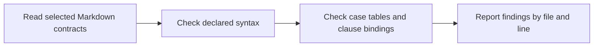

# Contract lint

Run `cargo run --locked -- lint --json CONTRACT.md` from the CAAC checkout.
Provide the Markdown contract paths you want to check. Clause IDs resolve across
the selected files. [JSON reference](contract-lint.json)

## Feature map

| Feature | Checks |
| --- | --- |
| Declared syntax | Clause shape, duplicate IDs, and unresolved references. |
| Case table | A case section with a table headed `Case`, `Input`, `Expected result`, and `Clauses`. |
| Case binding | Each row has four nonempty cells. Each comma-separated clause ID exists in the selected files. |

Name the section `Contract cases`, `Acceptance cases`, or `Cases`. Put the
header, divider, and rows on consecutive lines. List each clause ID with or
without a leading `@`. Escape a literal pipe in a cell as `\|`.

## Flowchart

Exit code 0 means the selected checks passed. Exit code 1 means the checks
found defects. Exit code 2 means an argument or input error. The JSON report
keeps semantic review pending. Case coverage, the meaning of expected results,
and execution evidence require their own review.
