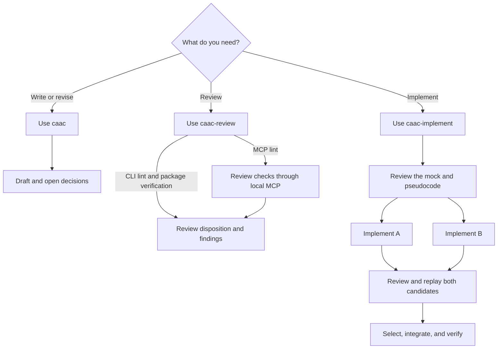

# CAAC skill workflows

Start with a CAAC skill to write or review a contract, or implement a reviewed clause. The review skill can run local MCP lint. The CLI also supports authoring and package verification. [JSON data](skill-workflows.json)

## Feature map

| User goal | Skill | Result |
| --- | --- | --- |
| Draft or revise a contract. | [`caac`](../.agents/skills/caac/SKILL.md) | A reviewable draft with open decisions and verification results. |
| Review an existing draft or package. | [`caac-review`](../.agents/skills/caac-review/SKILL.md) | A review disposition, cited findings, and owner decisions. |
| Implement a reviewed clause with independent candidates. | [`caac-implement`](../.agents/skills/caac-implement/SKILL.md) | A selected implementation with a recorded comparison and replay evidence. |

## Contract-first implementation

| Role | Responsibility |
| --- | --- |
| Designer | Pin the clause and cases. Sketch the interface, mock output, and critical pseudocode. |
| Implementers A and B | Build the same task in separate workspaces from the same reviewed inputs. |
| Reviewer | Challenge the mock first. Replay both completed candidates against the same acceptance cases. |
| Integrator | Select a base from the review, incorporate justified changes, and rerun the checks on the final code. |
| Owner | Resolve open contract policy and approve the exact revision when ready. |

## Local MCP review

Start the installed binary with `caac mcp` as a local stdio server. Use `caac_lint` to check the syntax and case references of selected Markdown. The CLI and MCP share the same Rust checks.

Send scope as `complete`, `partial`, or `unknown`. Send an ordered `documents` array with one to eight objects containing `name` and `markdown`. Each name must be unique and contain one to 128 Unicode scalar values with at least one non-whitespace character. Each document can contain up to 256 KiB of UTF-8 Markdown. The name is a display label. The stdio transport discards malformed JSON frames and lines over 16 MiB.

The structured result echoes the caller-declared scope and includes the SHA-256 of each document, lint status, diagnostics, and `semantic_review: pending`. A broken reference produces `lint: failed`. Invalid tool arguments produce a tool error. The tool reads and checks the supplied text in memory.

Run `cargo test --locked --test mcp` to replay initialization, discovery, valid and invalid inputs, cross-document references, CLI parity, and the maximum escaped input. Register the local command in your MCP client. In Codex, run `codex mcp add caac -- caac mcp`. Use an absolute path to the installed binary if the client cannot resolve `caac`.

```json
{
  "mcpServers": {
    "caac": {
      "command": "caac",
      "args": [
        "mcp"
      ]
    }
  }
}
```

Candidate verification and clause tracing remain available through the CLI. To assess coverage, the review skill needs an approved obligation list and an explicit review scope.

## Flowchart


